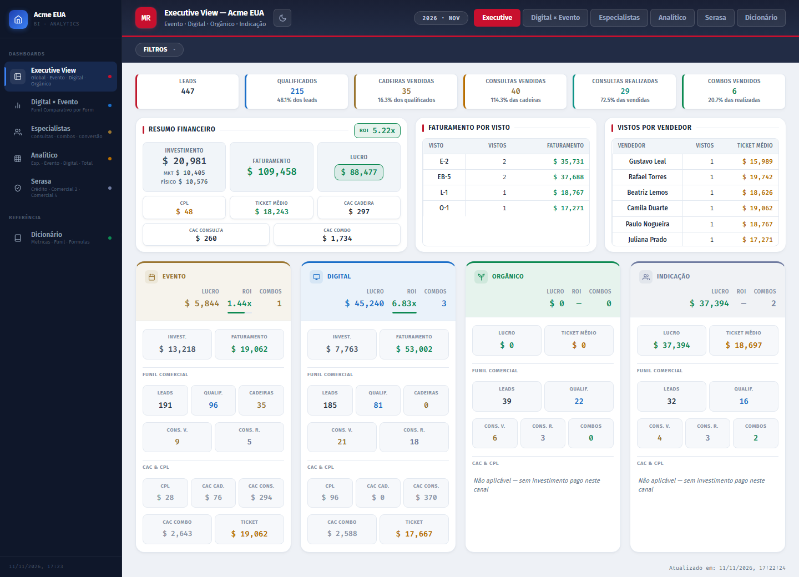
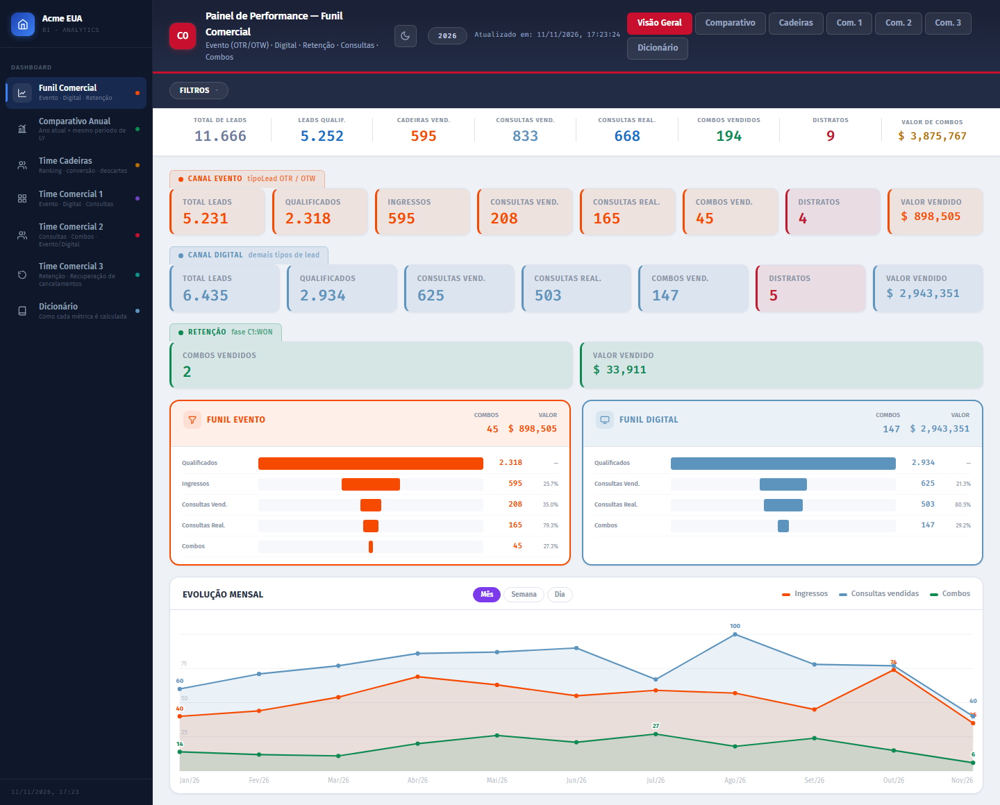
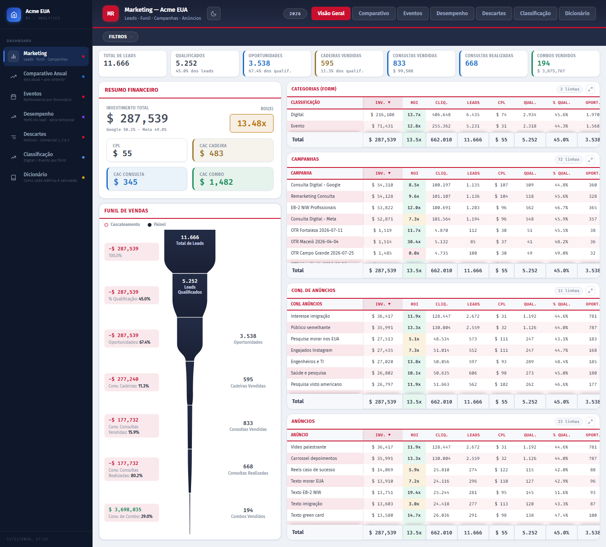
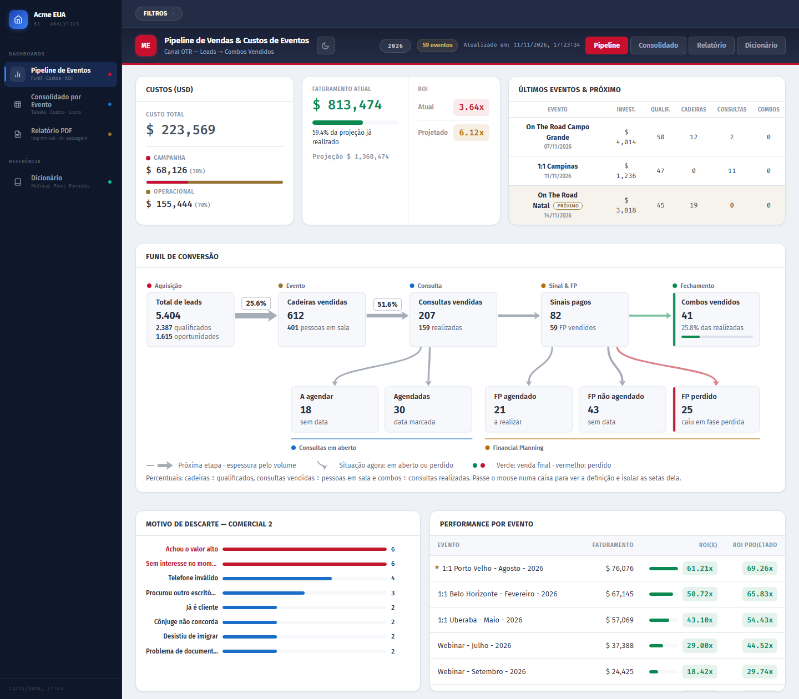
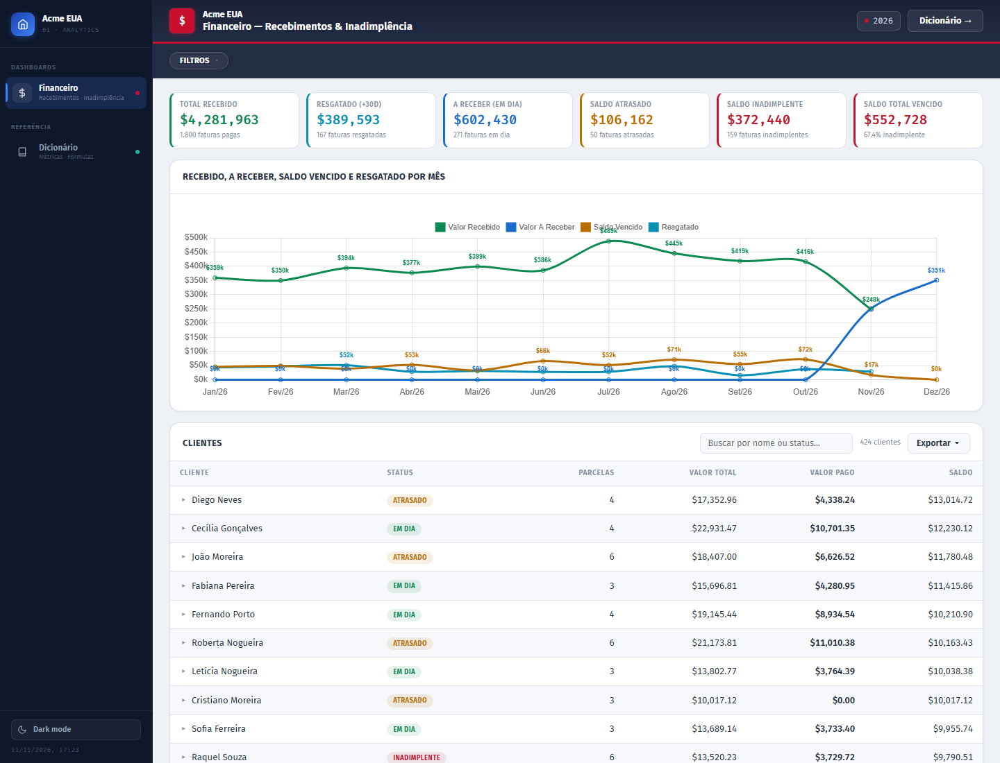
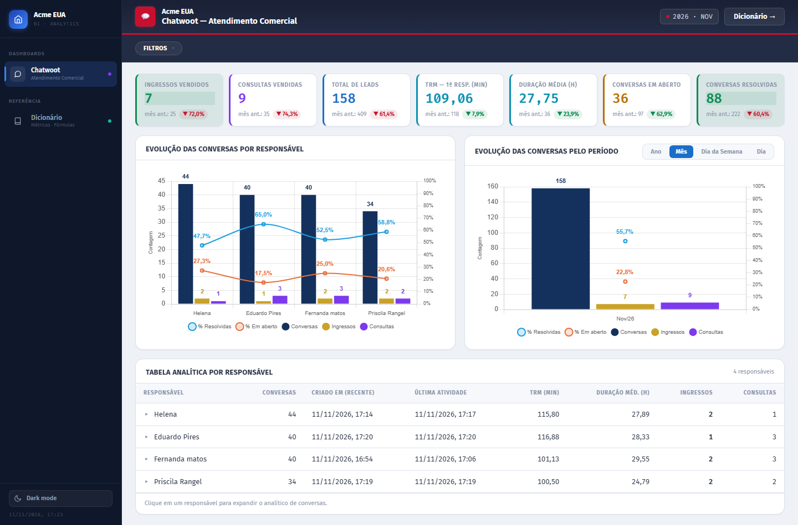
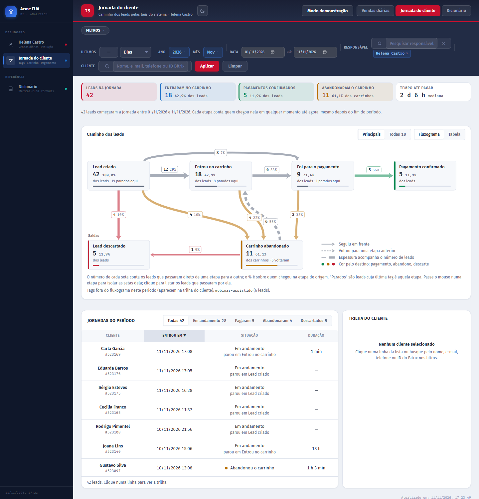
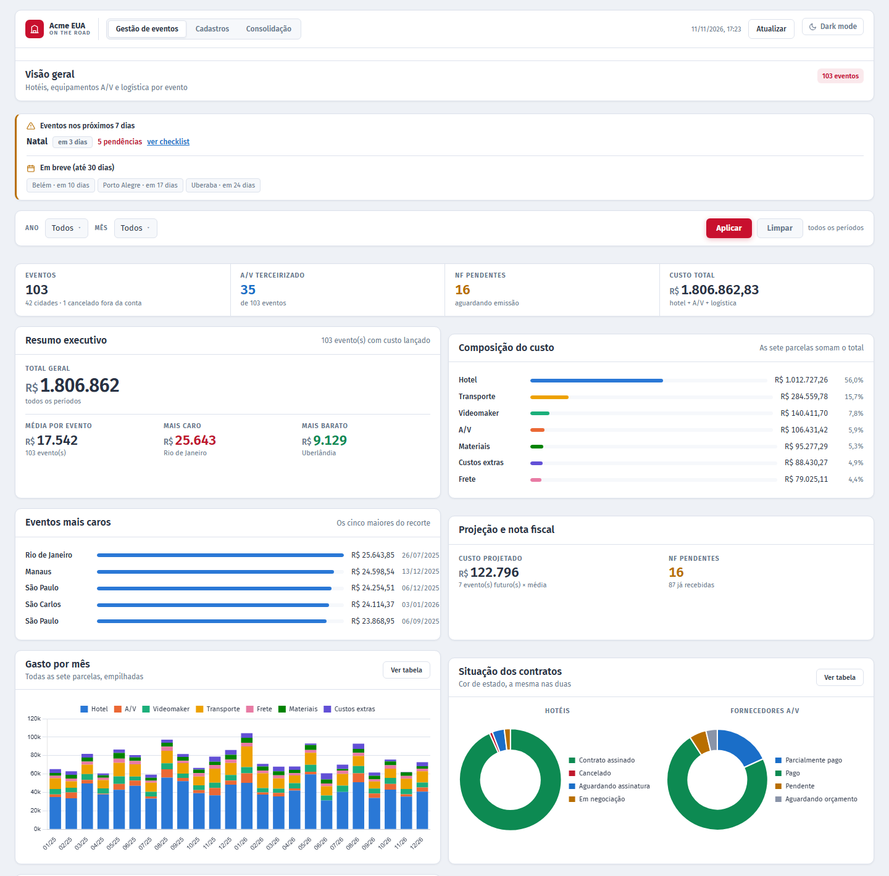

# BI Comercial: dashboards em PHP sobre um CRM

Plataforma de dashboards de BI de uma consultoria de imigração para os EUA. Cobre leads, funil comercial, marketing, eventos presenciais, financeiro, atendimento e o pós-venda jurídico. Os dados vêm do CRM, sincronizado num banco MySQL/MariaDB, e cada dashboard é uma tela web com filtros, KPIs, gráficos e tabelas.

São 21 controllers, 87 views e cerca de 70 mil linhas de PHP, além de um design system próprio em CSS. Não há build, npm nem Composer.

> **Sobre esta cópia.** É uma versão de portfólio. A marca ("Acme EUA"), os nomes de pessoas, os domínios e os IDs de serviços externos são fictícios. Não há credenciais nem dados de clientes: o banco é preenchido por um gerador de dados fictícios que acompanha o repositório.

## Como rodar

Pré-requisito: [Docker Desktop](https://www.docker.com/products/docker-desktop/) instalado e aberto.

```bash
git clone https://github.com/leonardoss02/Portfolio-BI.git
cd Portfolio-BI
docker compose up
```

Quando aparecer `Pronto em ... s` no terminal, abra **http://localhost:8000** e entre com **demo** / **demo**.

A cada subida o banco é recriado com dados fictícios que terminam no dia de hoje, então os filtros de "mês atual" sempre têm números. Para parar, use `Ctrl+C` (ou `docker compose down`).

**O que visitar:**

| Tela | Endereço |
|---|---|
| Executivo | http://localhost:8000/executive |
| Comercial | http://localhost:8000/comercial |
| Marketing | http://localhost:8000/marketing |
| Eventos | http://localhost:8000/eventos |
| Financeiro | http://localhost:8000/financeiro |
| Atendimento | http://localhost:8000/chatwoot |
| Jornada do cliente | http://localhost:8000/helenacastro/jornada |
| Gestão de Eventos | http://localhost:8000/hotel |

## Telas

| | |
|---|---|
|  |  |
|  |  |
|  |  |
|  |  |

## Dashboards

| Área | Rota | O que mostra |
|------|------|--------------|
| Executivo | `/executive` | Funil comercial completo, custo de marketing e de eventos convertido para USD, ROI, especialistas, analítico e consulta de crédito |
| Comercial | `/comercial` | Funil Evento × Digital × Retenção, comparativo ano × ano anterior e uma visão por time de vendas |
| Marketing | `/marketing` | Funil por campanha, conjunto e anúncio; desempenho; comparativo anual; motivos de descarte |
| Eventos | `/eventos` | Pipeline e consolidado por evento presencial, com o funil em fluxograma |
| Financeiro | `/financeiro` | Recebimentos e inadimplência a partir das faturas |
| Atendimento | `/chatwoot` | Conversas do time comercial: volume, vendas originadas na conversa, tempo de 1ª resposta, duração e status |
| Jurídico | `/law` | Casos pós-venda por responsável e etapa, com fila de alta prioridade |
| Customer Success | `/comercial4` | Funil do pós-venda (vendas, clientes, agendamentos) e uma campanha de metas da equipe com produtos de parceiros |
| Credenciados, Dentistas, NPS | `/credenciados`, `/dentistas`, `/npseventos` | Recortes por segmento e pesquisa de satisfação dos eventos |
| Vendedores | `/rafaeltorres`, `/julianaprado`, … | Um painel por vendedor. O `/helenacastro` acompanha o dia a dia e traz a **Jornada do cliente**, um fluxograma de coorte montado a partir das etapas que o CRM registra |
| Gestão de Eventos | `/hotel` | Sistema operacional (não é um dashboard): hotéis, equipamentos, transporte e custos de cada evento |

Cada dashboard tem um **dicionário de métricas** (`/{dashboard}/dicionario`). É uma página estática que explica cada número em linguagem de negócio, com a regra técnica recolhida logo abaixo.

## Stack

- **PHP 8** sobre o MRPHP, um framework MVC de entrada única e sem dependências: roteamento por URL, templates e acesso a banco
- **MySQL/MariaDB** via `mysqli`, sempre com prepared statements
- **JavaScript puro**, com Chart.js e ApexCharts carregados por CDN
- **CSS próprio** (`css/bi-theme.css`), com tokens de cor, tema claro e escuro e os componentes comuns (KPI, card, tabela, filtros recolhíveis, dicionário)
- **Docker Compose** para rodar localmente: PHP 8.3 com Apache e MariaDB 11.4

## Arquitetura

```
index.php                       entrada única
  └── MRPHP                     carrega .env, conecta ao banco, resolve a rota
        ├── controle/{nome}_controle.php    index() desenha a tela; dados() devolve JSON
        ├── template/{nome}.php             cabeçalho, menu e tema do dashboard
        └── paginas/{nome}/{metodo}.php     view: filtros, KPIs, gráficos (fetch no JSON)
```

Cada dashboard é um controller. A tela carrega uma vez, e o JavaScript chama o próprio controller (`/{nome}/dados?year=…&months=…`) a cada mudança de filtro. O SQL e o cálculo das métricas ficam em métodos privados do controller. Os dashboards não compartilham camada entre si, então um dashboard pode mudar sem afetar os outros. A exceção é a Gestão de Eventos, que grava no banco e por isso tem camadas próprias em `lib/hotel/` (repositório, schema declarativo, cálculo e importador).

## Base de dados fictícia

O `docker compose up` sobe três serviços: o banco (`db`), o gerador (`seed`), que recria as tabelas e grava os dados, e o site (`app`), que só sobe depois do gerador terminar.

O gerador (`database/seed/`) simula clientes percorrendo a jornada comercial (campanha → lead → cadeira no evento ou consulta digital → consulta → planejamento financeiro → combo → faturas e pós-venda). Por isso os números batem entre os dashboards: a venda que aparece no Executivo é a mesma que vira fatura no Financeiro e caso no Jurídico.

- Cerca de 23 mil leads, 6 mil cards no CRM e perto de 200 mil linhas no total, de 01/01/2025 até hoje (o volume cresce com o tempo)
- Mesma data = mesma base (semente aleatória fixa); só os horários de hoje acompanham a hora em que o gerador roda
- Volumes, taxas de conversão e nomes ficam em [`database/seed/config.php`](database/seed/config.php)
- O modelo de dados está explicado em [`database/README.md`](database/README.md), com diagrama

## Testes

Com o projeto no ar:

```bash
# testes do gerador (unitários)
docker compose run --rm --no-deps seed php tests/rodar.php

# teste de fumaça: visita todas as telas e endpoints e exige números nas métricas principais
APP_ENV_FILE=./docker/app.dev.env docker compose up -d      # no PowerShell: $env:APP_ENV_FILE='./docker/app.dev.env'; docker compose up -d
docker compose exec app php tests/smoke.php
```

O teste de fumaça roda com o site em modo DEV, em que qualquer aviso do PHP vira erro. Para provar que nada "envelhece" (anos fixos no código), gere a base para uma data futura e rode o grupo de envelhecimento:

```bash
docker compose run --rm seed php -d memory_limit=1024M database/seed/gerar.php --hoje=2027-03-15
docker compose exec app php tests/smoke.php --hoje=2027-03-15 --apenas=envelhecimento
```

## Decisões técnicas

**Filtro de data que usa índice.** O filtro de ano e mês não vira `YEAR(col) = ?` no SQL. O PHP converte a seleção num intervalo literal (`col >= ? AND col <= ?`), e o banco consegue usar o índice da coluna. Quando a "coluna" é uma expressão calculada, o filtro antigo continua valendo.

**Cache em arquivo por endpoint.** A resposta JSON fica em cache com chave derivada dos filtros. As partes que não dependem do filtro do usuário têm chave fixa e prazo mais longo.

**Menos idas ao banco.** KPIs que leem a mesma tabela com o mesmo filtro saem de uma só consulta, com `SUM(CASE WHEN …)` ou `UNION ALL`.

**Join entre tipos diferentes.** Um `INT` comparado a um `VARCHAR` de outra collation faz o MySQL ignorar o índice, e o `EXPLAIN` mostra "Range checked for each record". A correção, sem mexer no schema, é `CONVERT(coluna USING latin1)` no lado inteiro do join.

**Regras de dados do CRM tratadas no SQL:**
- datas `0000-00-00` contam como vazias (`IS NOT NULL` sozinho deixa passar);
- a tabela de câmbio tem várias cotações por dia, então é deduplicada com `MAX` antes do join para não inflar somas;
- custos em BRL são convertidos para USD pela cotação do dia.

**Segurança:**
- todo valor de filtro entra por `bind_param`, inclusive listas (`IN (?,?,…)`);
- as páginas exigem Basic Auth, e o embed em site parceiro só é liberado quando três condições valem juntas: `?to=1`, cabeçalho `Sec-Fetch-Dest: iframe` (o navegador envia e o JavaScript não falsifica) e origem do `Referer` na lista permitida;
- o endpoint de debug `/sql/query` aceita só leitura: lista de comandos permitidos, uma instrução por requisição, rate limit e token comparado com `hash_equals`;
- o único módulo que grava no banco usa exclusão lógica, nunca `DELETE`.

## Sem Docker

Com PHP 8 (extensões `mysqli` e `mbstring`) e um MySQL/MariaDB local, como XAMPP ou Laragon.

> **Use um banco vazio, criado só para isto.** O gerador apaga e recria 18 tabelas com nomes comuns (`evento`, `invoice`, `deal`…); num banco que já tenha tabelas com esses nomes, os dados delas seriam perdidos.

```bash
cp .env.example .env              # preencha DB_DEFAULT_* e DASH_AUTH_USER / DASH_AUTH_PASSWORD
php -d memory_limit=1024M database/seed/gerar.php   # cria as tabelas e os dados
php -S localhost:8000 index.php
```

## Problemas comuns

- **A porta 8000 (ou 3307) já está em uso.** Escolha outras e abra o site na porta nova (ex.: http://localhost:8080):
  - PowerShell (Windows): `$env:APP_PORTA=8080; $env:DB_PORTA=3308; docker compose up`
  - Mac/Linux (bash, zsh): `APP_PORTA=8080 DB_PORTA=3308 docker compose up`
- **"Cannot connect to the Docker daemon".** O Docker Desktop está fechado: abra-o e espere o ícone indicar que o motor está rodando.
- **O site não subiu.** Veja o que o gerador disse: `docker compose logs seed`. Se uma checagem falhou, a mensagem diz qual.
- **Quero recriar a base.** Rode `docker compose up` de novo: o gerador sempre recria tudo com dados até hoje.
- **Quero ver os dados num cliente SQL.** Conecte em `localhost:3307`, banco `acme_bi`, usuário `acme`, senha `acme`.
- **Apareceu um arquivo `.env` vazio na pasta.** É o Docker criando o ponto de montagem do `.env` de demonstração. Pode ignorar: ele está no `.gitignore`.
- **No começo do ano, alguns cards aparecem zerados.** Os dashboards abrem no ano corrente, e nos primeiros dias de janeiro ainda há pouco movimento no ano (uma fatura só fica "inadimplente" depois de 60 dias de atraso, por exemplo). Escolha o ano anterior no filtro para ver o ano completo.

## Estrutura

```
controle/          controllers, um por dashboard
paginas/           views (fragmentos HTML/PHP) e dicionários de métricas
template/          um template por dashboard: cabeçalho, menu, tema
css/               bi-theme.css (design system) e hotel.css
js/                bi-dashboard.js (dropdowns, formatadores, dicionário) e os scripts do módulo de eventos
lib/hotel/         camadas do módulo Gestão de Eventos
database/          schema.sql, gerador de dados fictícios (seed/) e documentação do modelo
docker/            imagem PHP e .env de demonstração
tests/             testes do gerador e teste de fumaça
docs/              prints das telas e documentos de design
mrphp.php          núcleo do framework
index.php          ponto de entrada
```
