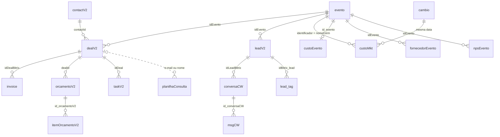

# Base de dados

O banco que os dashboards leem: 18 tabelas, criadas por [`schema.sql`](schema.sql) e preenchidas com dados fictícios pelo gerador em [`seed/`](seed/).

Os nomes de tabelas e colunas seguem o sistema original e não podem mudar sem mexer nos dashboards, porque cada controller consulta esses nomes diretamente. A convenção é tabela no singular, chave `id_{tabela}` e colunas `{campo}_{tabela}` (por exemplo, `faseId_dealV2`).

## Como as tabelas se ligam



As ligações com o CRM usam o ID do Bitrix (`idBitrix_*`), guardado como texto com dígitos. Não há chaves estrangeiras declaradas, como no sistema original, que sincronizava as tabelas a partir de APIs externas.

## Tabelas

| Área | Tabela | O que representa |
|---|---|---|
| CRM | `leadV2` | Cada formulário preenchido: origem (UTMs, formulário, evento), se foi qualificado, perfil profissional |
| CRM | `contactV2` | A pessoa. Um contato tem vários cards |
| CRM | `dealV2` | Os cards (negócios). Um cliente tem um card por etapa da jornada, cada um numa pipeline (tabela abaixo) |
| CRM | `taskV2` | Tarefas dos cards; prioridade 2 = alta (fila do Jurídico) |
| CRM | `lead_tag` | Histórico do lead no checkout: lead criado, carrinho, pagamento, abandono (Jornada do cliente) |
| CRM | `deal` | Tabela legada, sempre vazia; existe só porque o Financeiro faz um join nela |
| Marketing | `custoMkt` | Gasto diário por anúncio, com cliques. Contas "Dollar" em USD, as demais em BRL |
| Marketing | `cambio` | Cotação do dólar em reais, uma por dia |
| Eventos | `evento` | Eventos presenciais ("On The Road"), webinars e encontros 1:1 |
| Eventos | `custoEvento` | Custo físico de cada evento (BRL), igual à soma dos fornecedores |
| Eventos | `fornecedorEvento` | Hotel, equipamento, videomaker, transporte, frete, material e custos extras de cada evento, numa tabela larga separada por categoria |
| Financeiro | `invoice` | Faturas (espelho do QuickBooks), em USD: entrada e parcelas de cada combo |
| Pós-venda | `orcamentoV2`, `itemOrcamentoV2` | Orçamentos de upsell (produtos de parceiros) oferecidos pelo Customer Success |
| Atendimento | `conversaCW`, `msgCW` | Conversas e mensagens do WhatsApp e Instagram (espelho do Chatwoot) |
| Pesquisas | `npsEvento` | Respostas da pesquisa de satisfação dos eventos, de quem comprou consulta e de quem não comprou |
| Pesquisas | `planilhaConsulta` | Planilha em que o time do Comercial 2 anota as consultas realizadas, conferida contra o CRM |

## Pipelines do CRM (`faseId_dealV2`)

O prefixo da fase diz em qual pipeline o card está:

| Prefixo | Pipeline | Exemplos de fase |
|---|---|---|
| (sem prefixo) | Funil do evento: check-in e consulta vendida no evento | `WON`, `LOSE` |
| `C9` | Cadeiras (ingresso do evento) | `C9:WON` |
| `C11` | Consulta digital | `C11:WON` |
| `C5` | Comercial 2: consulta → sinal → planejamento financeiro (FP) → combo | `C5:WON`, `C5:UC_0Q30H1` (contrato enviado) |
| `C1` | Retenção: tenta recuperar quem perdeu | `C1:WON`, `C1:LOSE` |
| `C29`, `C31` | Combos fechados em outros pipes | `C29:WON`, `C31:WON` |
| `C3` | Pós-venda e Jurídico: arquitetura, milestones, aplicação, aprovação | `C3:NEW`, `C3:PREPARATION` |
| `C33` | Segmento Dentistas | `C33:WON` |

## Exceções à convenção

O código lê estes nomes literalmente, então eles ficaram como no sistema original:

- `lead_tag` tem colunas sem sufixo (`idBitrix_lead`, `tag`, `dataCadastro`…);
- `msgCW.id_conversaCW`, `custoEvento.id_evento` e `invoice.id_empresa` não têm sufixo;
- `ballancedQB_invoice` é escrito com dois L;
- `custoEvento` precisa ter exatamente as 7 colunas do schema: o módulo de Gestão de Eventos descobre as colunas e recusa qualquer outra.

## O gerador

Fica em [`seed/`](seed/): um arquivo por área de negócio em `seed/src/`, executados na ordem definida em [`seed/src/Gerador.php`](seed/src/Gerador.php). Cada etapa lê o que as anteriores criaram (não há venda sem lead, nem fatura sem combo) e as tabelas ficam em memória até o fim, quando o gerador confere a coerência e grava tudo de uma vez.

```bash
# com Docker (o docker compose up já faz isso)
docker compose run --rm seed php -d memory_limit=1024M database/seed/gerar.php

# opções
--hoje=AAAA-MM-DD   finge que hoje é outra data (mínimo 2026-06-01)
--escala=0.1        base menor, para testar rápido
--sem-banco         só gera e confere, sem gravar
```

Volumes, taxas de conversão, nomes e sazonalidade ficam em [`seed/config.php`](seed/config.php). Os nomes da equipe interna estão escritos no código dos dashboards; o teste `tests/seed/PessoasTeste.php` confere que o config bate com eles.
